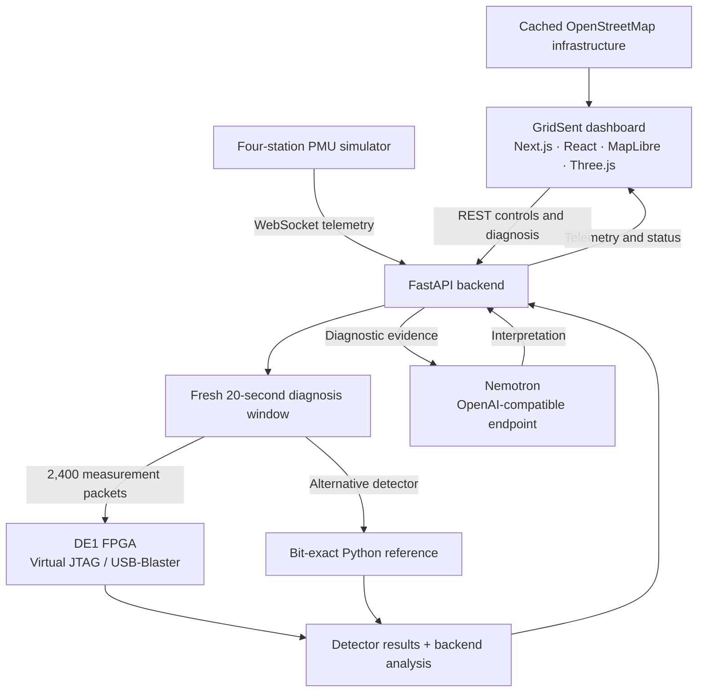

# GridSent

### Power grid oscillation detection, visualization, and AI-assisted diagnostics

GridSent combines simulated power-grid telemetry, FPGA signal processing, and an interactive dashboard to explore low-frequency oscillations across four substations.

Inject disturbances, detect oscillations using a physical FPGA or its bit-exact Python reference, inspect station behavior on a map and in 3D, and request an evidence-based interpretation from Nemotron.

> GridSent uses synthetic PMU telemetry alongside real infrastructure locations from OpenStreetMap. It is a demonstration platform, not a live utility monitoring system.

## Features

- **Live telemetry:** Four simulated Phasor Measurement Units (PMUs) stream frequency measurements at 30 samples per second per station.
- **Disturbance injection:** Independently control oscillation severity and phase for each station.
- **FPGA detection:** A Verilog correlator detects 0.25 Hz oscillations on an original Terasic DE1 board.
- **Hardware-free operation:** Run the same pipeline using a bit-exact Python reference detector.
- **Grid visualization:** Explore transmission substations, power lines, and plants across eight cached Texas regions.
- **Interactive 3D substations:** Inspect procedural substation models with live readings and disturbance indicators.
- **Diagnostic reports:** View detector energy, alarm states, severity classifications, amplitude estimates, and phase relationships.
- **Critical infrastructure context:** Explore nearby hospitals, water facilities, emergency services, and other critical sites.
- **AI interpretation:** Request Nemotron explanations grounded in diagnostic evidence, with simulator ground truth excluded from the prompt.

## Architecture



The live stream continuously visualizes station behavior. Each diagnosis generates a **fresh 20-second window** using the current disturbance settings and new noise, then sends it through the selected detector.

## Technology Stack

| Layer | Technologies |
|---|---|
| Dashboard | Next.js 16, React 19 |
| Mapping | MapLibre GL, OpenStreetMap, Overpass API |
| 3D visualization | Three.js |
| Backend | Python, FastAPI, Uvicorn, WebSockets |
| Signal analysis | NumPy, integer reference detector |
| Hardware | Verilog-2001, Terasic DE1, Cyclone II |
| FPGA tools | Quartus II 13.0 SP1, Virtual JTAG, USB-Blaster |
| AI interpretation | Nemotron through an OpenAI-compatible API |
| Testing | pytest, Node.js test runner, Icarus Verilog |

## Repository Structure

```text
.
├── frontend/              # GridSent web dashboard
│   ├── app/               # Pages, styles, infrastructure routes
│   ├── components/        # Map, 3D scene, waveform, controls, reports
│   ├── lib/               # API integration and visualization logic
│   ├── data/              # Cached grid and critical-facility data
│   ├── scripts/           # Infrastructure download utilities
│   └── tests/             # Frontend library tests
├── simulator/             # Live simulation and diagnostic API
│   ├── app.py             # REST API and WebSocket streaming
│   ├── live_sim.py        # Synthetic PMU signal generation
│   ├── diagnose.py        # Diagnosis pipeline and phase analysis
│   ├── detectors.py       # Reference and hardware detector backends
│   ├── nemotron.py        # AI interpretation integration
│   ├── packet_encoder.py  # FPGA measurement protocol
│   ├── data/              # Frozen binary and CSV test datasets
│   └── tests/             # Simulator, API, and diagnosis tests
├── fpga/
│   ├── rtl/               # Detector, parser, transport, and formatter
│   ├── tb/                # Verilog test benches
│   ├── quartus/           # DE1 project and pin assignments
│   └── tools/             # Reference model, JTAG host, replay tools
├── .env.example           # Optional model-server configuration
└── start.sh               # Stack launcher
```

## Quick Start — No FPGA Required

### Prerequisites

- Python 3.10 or newer
- Node.js 20.9 or newer
- npm

Run these commands from the repository root.

### 1. Start the backend

```bash
python3 -m venv .venv
source .venv/bin/activate
python -m pip install -r simulator/requirements.txt

python -m uvicorn simulator.app:app --reload --host 127.0.0.1 --port 8000
```

The backend uses the Python reference detector by default.

### 2. Start the dashboard

In a second terminal:

```bash
cd frontend
npm ci
npm run dev
```

### 3. Open the application

- Dashboard: http://localhost:3000
- Interactive API documentation: http://localhost:8000/docs
- Backend health: http://localhost:8000/api/health

Next.js proxies `/api/*` and `/ws/stream` to the backend on port 8000.

## Running with the FPGA

### Hardware Requirements

- Original **Terasic DE1** with a **Cyclone II EP2C20F484C7**
- USB-Blaster connection
- Windows with **Quartus II 13.0 SP1**, Cyclone II support, and the USB-Blaster driver
- WSL with Windows interoperability enabled
- Python and Node.js available in WSL

### Start the Complete Stack

From the repository root in WSL:

```bash
bash start.sh
```

The launcher installs missing application dependencies, builds the frontend, compiles and programs the DE1, and starts the backend and dashboard.

Open http://localhost:3000. Press `Ctrl+C` to stop the services.

Additional modes:

```bash
# Use a board that already has the current bitstream
bash start.sh --skip-program

# Use the Python reference detector without a board
bash start.sh --reference

# Expose the dashboard through the Windows Wi-Fi relay
bash start.sh --lan <windows-wifi-ipv4>
```

The default Quartus directory is `C:\altera\13.0sp1\quartus\bin64`. Run `bash start.sh --help` for launcher overrides.

For manual compilation, programming, board controls, and hardware verification details, see [fpga/README.md](fpga/README.md).

## Using GridSent

1. **Choose a region.** Select a cached Texas region from the map.
2. **Assign substations.** Click a transmission substation and assign it to station 1–4, or preview it in 3D.
3. **Configure a disturbance.** Choose each station’s severity and phase, then select **Inject disturbance**.
4. **Observe the signals.** Watch frequency deviations, map indicators, and the 3D substation view respond.
5. **Run diagnosis.** Inspect per-station energy, alarms, severity, and phase relationships.
6. **Request interpretation.** If Nemotron is configured, generate an explanation of the recorded evidence.

The interface labels stations **1–4**. The backend names them **North, East, South, and West**, respectively.

## Detection Pipeline

The simulator models a nominal **60 Hz** signal with shared drift, independent measurement noise, and configurable **0.25 Hz** oscillations.

Each diagnosis processes:

- **600 samples per station**
- **20 seconds of simulated signal**
- **4 stations**
- **2,400 seven-byte measurement packets**
- **4 detector results**

The FPGA correlates frequency deviations against fixed sine and cosine coefficients and computes:

```text
Energy = I² + Q²
```

An alarm triggers at a raw energy of **2,250,000**. The dashboard converts raw energy from mHz² to Hz², displaying the threshold as **2.25 Hz²**.

| Severity | Injected amplitude | Detector energy, displayed |
|---|---:|---:|
| Normal | 0 mHz | < 2.25 Hz² |
| Mild | 7 mHz | ≥ 2.25 and < 9 Hz² |
| Moderate | 14 mHz | ≥ 9 and < 36 Hz² |
| Severe | 30 mHz | ≥ 36 Hz² |

The backend separately estimates oscillation amplitude and phase, classifies the event as affecting zero, one, or multiple stations, and compares phase relationships between alarmed stations.

### Detector Modes

| Mode | Description |
|---|---|
| `reference` | Bit-exact Python model of the FPGA’s integer arithmetic; default for manual backend startup |
| `hardware` | Sends measurements to the DE1 through Windows Quartus and Virtual JTAG |

The default `start.sh` mode selects hardware detection.

## Optional Nemotron Integration

Copy the example configuration:

```bash
cp .env.example .env
```

Configure the repository-root `.env` for your running model server:

```dotenv
NEMOTRON_BASE_URL=http://127.0.0.1:8001/v1
NEMOTRON_MODEL=your-served-model-id
NEMOTRON_API_KEY=
NEMOTRON_TIMEOUT_SECONDS=90
NEMOTRON_MAX_TOKENS=2048
```

The endpoint must be reachable from the Python backend. The model server runs separately.

After completing a diagnosis, select **Request interpretation** in the dashboard.

Nemotron receives detector output, measured amplitude and phase estimates, and optional nearby-facility context. Simulator injection settings and expected outcomes are removed before inference. The dashboard labels the interpretation as AI-generated.

## Infrastructure Data

GridSent includes cached OpenStreetMap transmission infrastructure for:

- Brazos Valley / College Station — default
- Austin
- Houston
- Dallas–Fort Worth
- San Antonio
- Corpus Christi
- Laredo
- Rio Grande Valley

Critical-facility data is included for all listed regions except Rio Grande Valley. Categories include hospitals, military sites, water and wastewater facilities, oil and gas sites, emergency services, airports, data centres, and universities.

Facility attribution uses the nearest transmission substation within **10 km**. This is a proximity estimate; it does not establish electrical connectivity or a confirmed service area.

Refresh cached data from `frontend/`:

```bash
npm run regions -- houston --force
npm run facilities -- houston --force
```

Infrastructure data is sourced from [OpenStreetMap](https://www.openstreetmap.org/copyright) contributors through the Overpass API.

## Configuration

| Variable | Default | Purpose |
|---|---|---|
| `SIM_DETECTOR` | `reference` | Select `reference` or `hardware` |
| `SIM_QUARTUS_STP` | Unset | WSL path to Windows `quartus_stp.exe` |
| `SIM_SEED` | Random | Seed for reproducible live telemetry |
| `SIM_BATCH` | `3` | Samples per WebSocket message |
| `SIM_SPEED` | `1` | Simulation time multiplier for testing |
| `SIMULATOR_URL` | `http://127.0.0.1:8000` | Frontend proxy destination |

Set `SIM_*` variables in the backend process environment. Set `SIMULATOR_URL` in the frontend environment before starting development or building for production. Nemotron settings can be read from the root `.env`; process environment variables take precedence.

## API Overview

| Method | Endpoint | Purpose |
|---|---|---|
| `GET` | `/api/health` | Backend health |
| `GET` | `/api/config` | Station metadata and detector settings |
| `GET` | `/api/state` | Current simulator state |
| `GET` | `/api/status` | Stream, detector, and model status |
| `PUT` | `/api/anomaly` | Set disturbance severity and optional phases |
| `DELETE` | `/api/anomaly` | Clear disturbances and restore default phases |
| `POST` | `/api/stream/pause` | Pause telemetry |
| `POST` | `/api/stream/resume` | Resume telemetry |
| `POST` | `/api/stream/reset` | Restart the stream |
| `POST` | `/api/diagnose` | Run a diagnosis |
| `GET` | `/api/diagnoses` | Retrieve recent diagnoses |
| `POST` | `/api/diagnoses/{id}/explain` | Request AI interpretation |
| WebSocket | `/ws/stream` | Receive telemetry, state, status, and results |

Example disturbance:

```bash
curl -X PUT http://localhost:8000/api/anomaly \
  -H "Content-Type: application/json" \
  -d '{"North":"severe","South":"mild"}'
```

This replaces the severity configuration; omitted stations return to normal.

Run a diagnosis:

```bash
curl -X POST http://localhost:8000/api/diagnose
```

## Testing

### Backend

From the repository root with the Python environment activated:

```bash
python -m pytest simulator/tests
```

Tests cover signal generation, phase transitions, all 256 station/severity combinations, packet encoding, API behavior, WebSocket streaming, and model-request contents.

### Frontend

```bash
cd frontend
npm test
npm run build
```

### FPGA

Install Icarus Verilog so `iverilog` and `vvp` are on your path, then run:

```bash
cd fpga
make PYTHON=python3 test
```

The suite covers UART transport, packet parsing, station routing, correlation arithmetic, result formatting, error handling, and Virtual JTAG integration.

The FPGA README records a physical DE1 replay of the grid-oscillation dataset in which all 12 returned results matched the Python reference exactly.

## Scope and Limitations

- Telemetry is synthetic; mapped infrastructure locations are real.
- Detection targets a fixed **0.25 Hz** oscillation.
- Diagnosis analyzes a newly generated window using current settings, rather than replaying the visible live history.
- All connected clients share one simulator and its controls.
- The backend keeps the latest 20 diagnoses in memory; they are lost on restart.
- Facility proximity and phase relationships do not establish outage impact, electrical connectivity, or an oscillation source.
- The application does not include authentication and is intended for local demonstrations or trusted networks.

## Component Documentation

- [Dashboard](frontend/README.md)
- [Simulator and API](simulator/README.md)
- [FPGA implementation and hardware setup](fpga/README.md)
