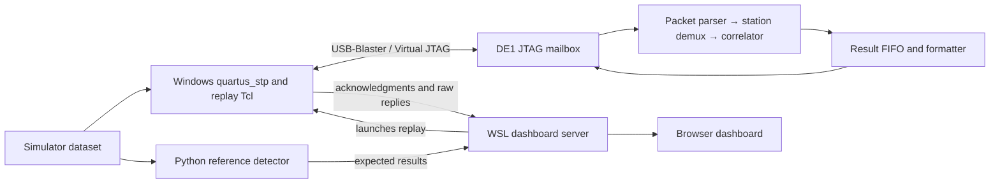

# Oscillation Cartographer FPGA MVP

Verilog-2001 implementation for the **original Terasic DE1, Cyclone II**.
All project files and generated outputs stay under `fpga/`. The existing
simulator and its seven-byte protocol are unchanged.

## Architecture



The DE1 Quartus project enables `DE1_VIRTUAL_JTAG`. The Windows
`quartus_stp` process runs `tools/jtag_replay.tcl` through the same
USB-Blaster connection used to program the FPGA.

- `rtl/jtag_transport.v` instantiates Altera's `sld_virtual_jtag` IP.
  Its 128-bit scans carry reset, measurement, and result-consume commands
  and return mailbox status and raw result bytes.
- Synchronized request and acknowledgment signals pass each seven-byte
  measurement from the JTAG clock to the 50 MHz FPGA clock. The mailbox
  acknowledges after supplying all seven bytes to the parser.
- The parser checks packet fields and checksum, and the station demultiplexer
  enforces sample order. The correlator computes 0.25 Hz energy and alarms
  over 600 samples per station.
- The result FIFO and formatter feed 14-byte packets to the mailbox, which
  holds one complete reply until the host consumes it. The host drains four
  station results after every 2,400 measurements.
- The dashboard reads replay progress and hardware replies, checks packet
  fields and checksum, and compares each decoded result with the independent
  Python reference.


## Verification status

The full Icarus Verilog regression suite passed in WSL. The Virtual JTAG
integration bench matched all 12 replies for the grid oscillation dataset.

- UART RX/TX, parser, station routing, UART echo and reset/error handling.
- Single-station and four-station integer correlation, including signed limits,
  600th-sample contribution, partial windows, DC, noise, opposite phase and 1 Hz.
- Every completed window in each original 8,400-packet dataset: exact integer
  energy and alarm equality, followed through the serialized result packets.
- A separate UART-input integration run: 2,400 measurements / four results.
- FIFO stalls, four closely spaced results, pointer wrap, zero extension and
  explicit overflow handling. Python result decoder and concurrent replay
  against a simulated serial peer with fragmented reads and short writes.
- Existing simulator suite: 18 tests passed, run without changing its files.

Quartus II 13.0 SP1 compiled and programmed the Virtual JTAG build on Windows.
TimeQuest reported 1.532 ns of worst-case setup slack at 50 MHz. The physical
DE1 acknowledged all 8,400 grid oscillation measurements and returned 12
checksum-valid packets. All 12 matched the Python reference exactly. The normal
and isolated datasets were verified in RTL simulation.

## Run tests on macOS

From the repository root:

```bash
brew install icarus-verilog
cd fpga
python3 -m venv .venv
.venv/bin/python -m pip install -r requirements.txt
make test
make test-uart
make test-parser
make test-detector
make test-integration
```

`make test` runs all self-checking benches plus Python checks. Each failure
returns a nonzero exit code; successful stages print `PASS`. No GTKWave or
Quartus installation is needed. The numerical reference and vector tools use
only Python's standard library. `make PYTHON=python3 test` also works without a
venv. `pyserial` supports the legacy serial replay tool. The JTAG dashboard uses
only the Python standard library. NumPy/pytest are included for
working alongside the simulator. Its CLI plot tests also require matplotlib.

Additional targets: `test-echo`, `test-formatter`, `test-faults`, `test-tools`,
`vectors`, `clean`. Generated hex files, executable simulations, decoded
captures and waveforms belong in the ignored `build/` directory.

`make test-detector` first exercises station 0 alone, then the shared datapath
with all four stations, including consecutive-clock inputs. `make
test-integration` injects decoded UART bytes at the parser for all 58,800 bytes
of each dataset; it still checks output using an independently instantiated
UART receiver. It then exercises the serial input itself on a smaller dataset
prefix. UART benches use 16 clocks/bit to reduce run time. The standalone UART RTL defaults to
434 clocks/bit (50 MHz / 115200, rounded).

## Simulator contract checked before implementation

Inspected `simulator/packet_encoder.py`, `tests/test_generator.py`, scenario
constants and actual CSV/binary datasets. Each file has 8,400 packets / 58,800
bytes, in sample-major then North/East/South/West order. All binary values agree
with the CSV deviations. `AA 02 64 00 F0 FF FF` decodes as station 2, index 100,
−16 mHz. Header, signed two's complement, little-endian fields and modulo-256
checksum match the requested contract. The generic Python encoder allows IDs
0–255; this FPGA correctly rejects IDs outside 0–3.

Measurement packet (7 bytes):

| Offset | Field |
|---|---|
| 0 | `AA` |
| 1 | Station 0–3 |
| 2–3 | Sample index, unsigned 16-bit little-endian |
| 4–5 | Deviation in mHz, signed 16-bit little-endian |
| 6 | Sum of bytes 0–5 modulo 256 |

Result packet (14 bytes):

| Offset | Field |
|---|---|
| 0 | `55` |
| 1 | Station 0–3 |
| 2–3 | Window end sample index, unsigned little-endian |
| 4–11 | Energy, unsigned 64-bit little-endian (upper nine bits zero) |
| 12 | Alarm, exactly 0 or 1 |
| 13 | Sum of bytes 0–12 modulo 256 |

There is no end-of-stream or error packet in this MVP. Check LEDR[4] during
hardware runs. Host tools detect missing/extra result packets and malformed
output. A missing sample is detected when the next received station/index
violates the expected order. A silent loss at the very end of an incomplete
window cannot be distinguished from a stopped replay by the FPGA protocol.

## RTL design

`top.v` connects the Virtual JTAG transport to the parser and formatter in the
board build. The legacy UART benches exercise UART RX/TX and echo mode.

- RX has a two-flop synchronizer, midpoint start validation, eight LSB-first
  data samples, stop validation and a one-cycle valid/error pulse. Invalid stop
  bits require a return to idle high before accepting another start bit.
- The parser consumes exactly seven bytes after a header. Payload `AA` bytes
  do not restart framing. It rejects invalid station IDs/checksums. An
  incomplete packet times out after 20 ms without a byte. A UART framing error
  aborts parser state through its reset input; top latches the error.
- `station_demux.v` starts at station 0 / index 0 and enforces the documented
  order. Each station retains its latest sample, accepted count and index.
  The index tracker is 17 bits so a 16-bit input wrap cannot silently restart.
- `correlator.v` keeps separate I/Q accumulators, phase, window count, energy,
  window end and published alarm state per station. The arithmetic datapath is
  shared across stations: two 16×16 signed multipliers, sign-extended 42-bit
  accumulation, and a window-completion stage with two 27×27 signed squares.
  It accepts one sample per clock and advances only on `sample_valid`.
- ROM constants are generated offline with Python `round(32767*cos(...))` and
  `round(32767*sin(...))` over 120 entries. No real arithmetic is synthesized.
  Regenerate with `python tools/generate_coefficients.py`; `--check` detects
  stale constants. Tiny coefficient rounding asymmetry gives energy 16 for a
  constant +32767 mHz input, negligible against the threshold.
- The completed I/Q sums include sample 600 before clearing. Bits `[41:15]`
  implement arithmetic shift right by 15 with signed 27-bit outputs. Signed
  54-bit squares are zero-extended before their unsigned 55-bit sum. Even a
  conservative bound `600*32768*32767` fits the signed 42-bit accumulators.
- Windows are non-overlapping: end indices 599, 1199, 1799, etc. The last
  300 samples of a default dataset do not publish a result.
- The output FIFO holds eight pending packets plus the active packet. Its
  ready/valid byte interface stalls safely when the transport applies backpressure. Overflow
  latches a fatal stream error rather than silently accepting lost results.
  This depth covers four station completions even in the fast parser tests.

Packet, timeout, ordering and queue errors latch until KEY0 or a JTAG reset.
They invalidate published alarms and window-valid LEDs and flush pending
formatter data. The host checks the JTAG error status and stops replay on a
latched error. A new replay resets detector state and starts at sample zero.

## Dataset measurements

Threshold remains **2,250,000** (`top.ENERGY_THRESHOLD` and
`correlator.ENERGY_THRESHOLD`), equivalent to approximately 5 mHz sinusoidal
amplitude for 600 samples. No threshold adjustment was needed.

Energies for the fully post-disturbance window **samples 1200–1799**:

| Dataset | North | East | South | West | Alarms N/E/S/W |
|---|---:|---:|---:|---:|---|
| normal | 170 | 377 | 778 | 68 | OFF/OFF/OFF/OFF |
| grid_oscillation | 36,180,241 | 12,972,698 | 26,255,412 | 4,419,405 | ON/ON/ON/ON |
| isolated | 56,355,130 | 377 | 778 | 68 | ON/OFF/OFF/OFF |

Each full file produces exactly 12 results. First-window results include onset
and are not expected to have the same alarm pattern as settled windows. The
reference uses Python integers and the exact ROM coefficients; the FPGA tests
require exact equality for every energy, index, station and alarm, not tolerance.

From the repository root:

```bash
python fpga/tools/reference_detector.py simulator/data/grid_oscillation.bin
python fpga/tools/reference_detector.py simulator/data/grid_oscillation.csv
python fpga/tools/decode_results.py fpga/build/grid_oscillation.results.hex --hex \
  --output fpga/build/grid_oscillation.json
```

`decode_results.py` also reads raw serial captures, supports CSV output and
validates header, station, 55-bit zero extension, alarm and checksum. It buffers
partial serial reads. On corrupt bytes it can resynchronize, but reports a
failed replay rather than silently treating recovered data as a clean run.

## Board assignments and controls

The assignments were checked against the original **DE1 User Manual**:
[manufacturer download](https://www.terasic.com.tw/attachment/archive/83/DE1_UserManual_v1018.pdf)
and [accessible mirror of the Altera-authored manual](https://dl.btc.pl/kamami_wa/terasic_de1_de1_usermanual_v1018.pdf),
tables 4.1–4.3 (printed pp. 28–29), 4.5 (p. 32) and 4.10 (p. 39).
The manual identifies the Cyclone II 2C20 / 484-pin family/package. The Quartus project selects **EP2C20F484C7** in `quartus/de1.qsf`.

| Top port | Board resource | FPGA pin |
|---|---|---|
| CLOCK_50 | 50 MHz oscillator | L1 |
| RESET_N | KEY0, active-low reset | R22 |
| LEDR[0:3] | North/East/South/West alarms | R20/R19/U19/Y19 |
| LEDR[4] | Latched packet/stream/queue error | T18 |
| LEDR[5] | At least one published window, valid | V19 |
| LEDG[0] / [1] | Measurement / result activity, stretched 100 ms | U22/U21 |
| LEDG[7] | 1 Hz heartbeat | Y21 |

LEDG[2:6] are off and assigned to their original DE1 pins. KEY0 resets the detector. The JTAG host also resets it before each replay.

## Compile and program on Windows

Install Quartus II 13.0 SP1 with Cyclone II support and the USB-Blaster driver.
Power on the original DE1, connect the board's USB-Blaster port and set RUN/PROG
to RUN. From `fpga/quartus` in PowerShell, with the Quartus bin directory on
PATH, run:

```powershell
quartus_sh --flow compile de1
quartus_pgm --% -c 1 -m JTAG -o "P;output_files\de1.sof@1"
```

Use `quartus_pgm -l` to confirm the cable number. This loads FPGA SRAM.
Reprogram the board after a power cycle.

## Live hardware dashboard

In WSL, from the repository root:

```bash
python3 fpga/tools/dashboard.py --port 8766
```

Open [localhost:8766](http://localhost:8766), pick a dataset and click **Run on
FPGA**. The server launches Windows `quartus_stp.exe` through WSL
interoperability. Pass `--quartus-stp /mnt/c/path/to/quartus_stp.exe` if
Quartus is installed elsewhere. The dashboard uses the Python standard library.

Each run resets the detector via JTAG, sends the original seven-byte packets,
and receives the FPGA's 14-byte replies. The measurement counter uses FPGA
mailbox acknowledgments. A reply appears after each station completes a
600-sample window. The dashboard validates the raw reply header and checksum,
then compares station, window end, energy and alarm against the independent
Python reference. A complete dataset should show **8,400 measurements sent**,
**12 results returned** and **Hardware results verified**. LEDG[0] and LEDG[1]
indicate measurement and result activity. LEDR[4] indicates a stream error.

To replay directly from Windows PowerShell at the repository root:

```powershell
quartus_stp -t fpga/tools/jtag_replay.tcl simulator/data/grid_oscillation.bin
```

The CLI reports acknowledged progress and raw results. For an exact reference
comparison, use the dashboard. Run `make test-jtag` from `fpga/` for the RTL
simulation of the mailbox and detector.

The Quartus build uses Virtual JTAG in detector mode. UART modules, echo mode
and the serial replay tool are retained for the legacy UART simulation path.
